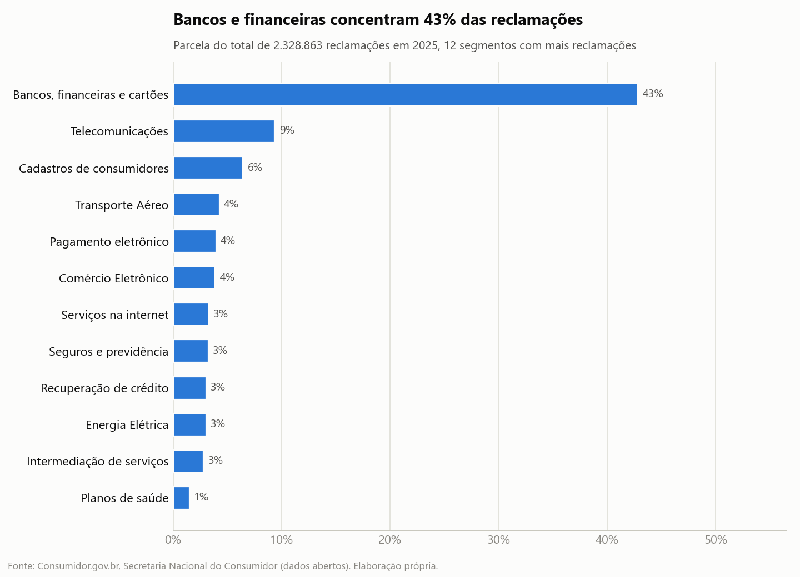
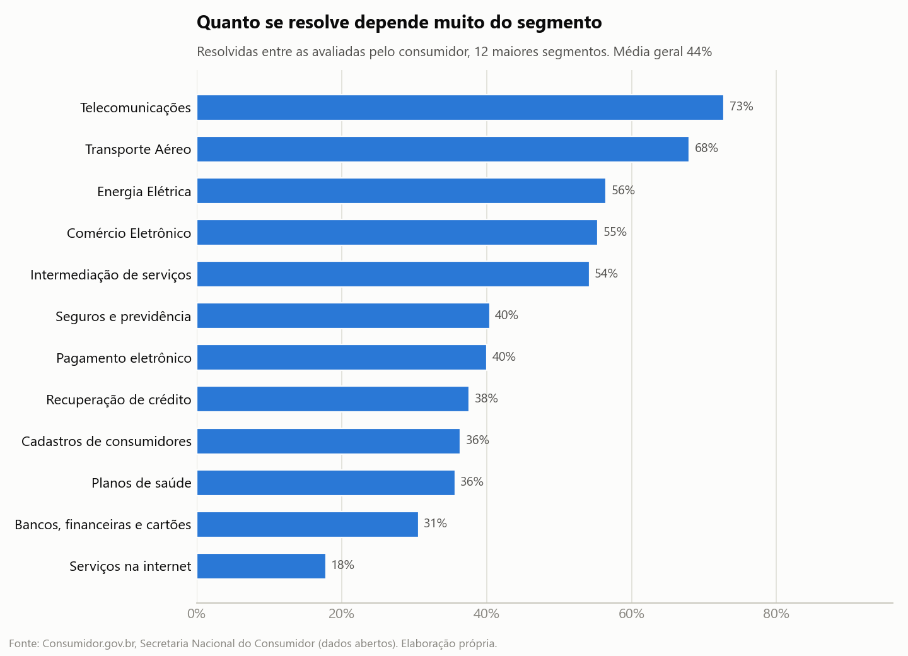
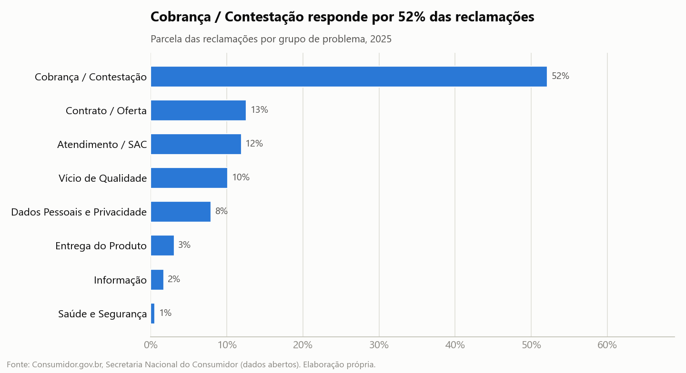
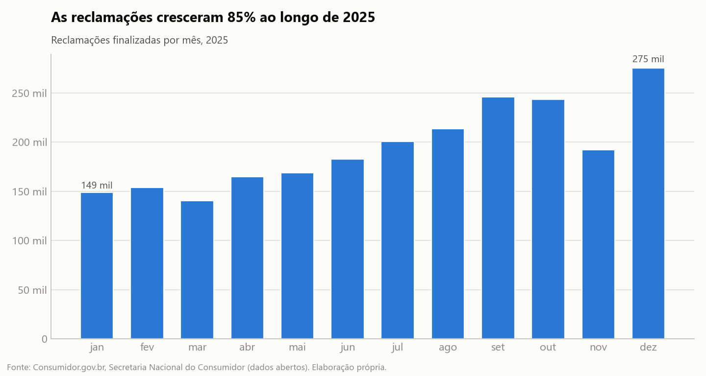

# Reclamações no Consumidor.gov.br

Quais setores e empresas concentram as reclamações dos consumidores brasileiros, e quais de fato resolvem?

Análise das 2.328.863 reclamações finalizadas na plataforma Consumidor.gov.br em 2025, contra 1.741 empresas.

## Principais resultados

* **Bancos e financeiras concentram 43% das reclamações** e resolvem só 31% delas, segundo a avaliação dos próprios consumidores. Operadoras de telecomunicações resolvem 73% e companhias aéreas, 68%.
* **Responder não é resolver.** As empresas respondem 97% das reclamações, em 6 dias em média. Mas, entre os consumidores que avaliaram o atendimento, só 44% consideraram o problema resolvido.
* **A avaliação é polarizada.** Metade das notas é 1 e 28% são 5, numa escala de 1 a 5. A nota média é 2,6.
* **Entre as 20 empresas mais reclamadas, o índice de solução vai de 12% a 78%.** Vivo, Azul, Latam, Claro e Tim resolvem três em cada quatro reclamações. Facebook e Instagram (12%), Nubank (17%) e Google (18%) ficam no fim da lista.
* **O Nubank é a empresa mais reclamada do país**, com 151 mil reclamações, à frente da Serasa Experian (144 mil) e do Santander (84 mil).
* **Cobranças são o principal motivo.** Cobrança e contestação de valores respondem por 52% das reclamações.
* **O volume cresceu 85% ao longo do ano**, de 149 mil reclamações finalizadas em janeiro para 275 mil em dezembro.










## Indicadores

São os mesmos que a plataforma usa para avaliar as empresas.

| Indicador | Cálculo |
|---|---|
| Índice de resposta | reclamações respondidas pela empresa, dividido pelo total |
| Tempo de resposta | média de dias até a resposta (o prazo máximo é de 10 dias) |
| Índice de solução | reclamações avaliadas como resolvidas, dividido pelas avaliadas |
| Satisfação | nota média de 1 a 5, entre as avaliadas |

Só 33% dos consumidores avaliam o atendimento. O índice de solução e a nota descrevem esse grupo, que pode ser diferente de quem não avalia. Quem teve o problema resolvido talvez avalie menos, por exemplo.

## Fonte

Dados abertos do Consumidor.gov.br, da Secretaria Nacional do Consumidor (`https://www.consumidor.gov.br/pages/dadosabertos/externo/`). O site publica um zip por mês com as reclamações finalizadas. Cada linha traz região, UF, cidade, sexo e faixa etária do consumidor, empresa, segmento, assunto, problema, canal de compra, resposta, avaliação e nota.

A base não traz o texto das reclamações, só as categorias. Por isso a análise dos motivos usa os grupos de problema e os problemas da classificação oficial.

## Método

1. **Download** (`baixar_consumidor.py` e `links_2025.html`). O site tem uma proteção contra robôs que recusa downloads feitos por script, então os 12 zips mensais são baixados pelo navegador. O script encontra os zips, confere o tamanho de cada um com o publicado no site e junta tudo em `dados/consumidor_2025.csv.gz`, compactado com gzip (68 MB em vez de 808 MB).
2. **Limpeza** (`limpar.py`). Padroniza os nomes das colunas e cria os campos de análise, como mês, se foi respondida, se foi avaliada e se foi resolvida. Confere datas, empresas e notas. As duas colunas que só aparecem em setembro ficam de fora.
3. **Análise** (`analisar.py`). Calcula os indicadores por mês, segmento, empresa, grupo de problema, UF, faixa etária, sexo e canal de compra. As tabelas vão para `resultados/` e os gráficos para `figuras/`. O ranking completo de empresas com pelo menos 5 mil reclamações está em `resultados/ranking_empresas.csv`.

## Como rodar

1. Abra `links_2025.html` no navegador e baixe os 12 arquivos.
2. Rode os scripts.

```bash
pip install -r requirements.txt
python baixar_consumidor.py   # junta os zips de 2025
python limpar.py
python analisar.py
```

No Windows com Miniconda, use `rodar_consumidor.bat` para o primeiro passo.

Os dados não ficam no repositório. As tabelas de resultado e os gráficos ficam.
