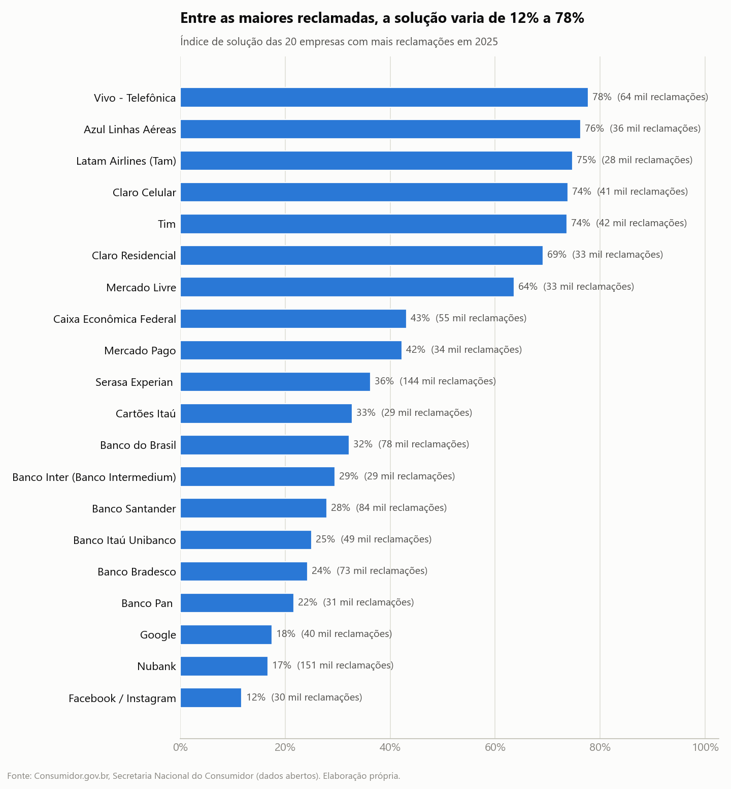
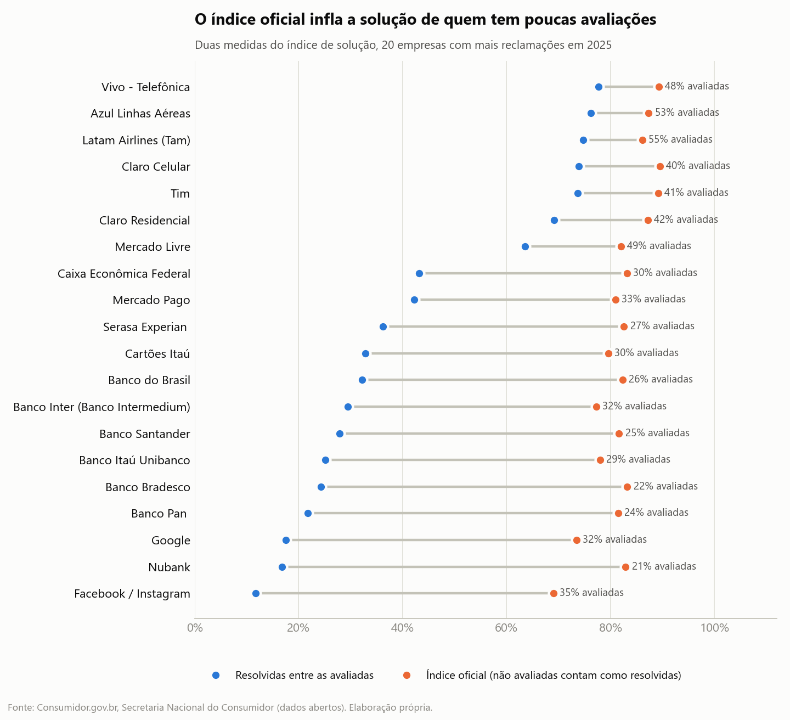
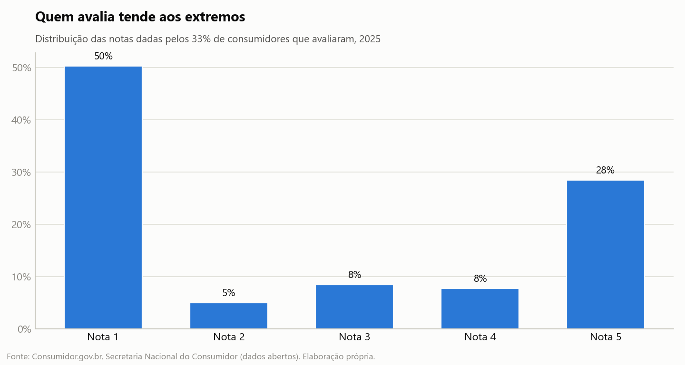
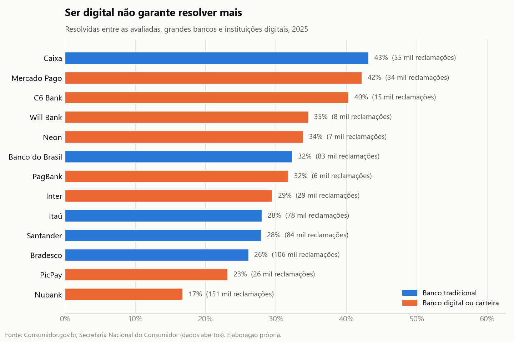

# Reclamações no Consumidor.gov.br

Quais setores e empresas concentram as reclamações dos consumidores brasileiros, e quais de fato resolvem?

Análise das 2.328.863 reclamações finalizadas na plataforma Consumidor.gov.br em 2025, contra 1.741 empresas.

## Principais resultados

* **Bancos e financeiras concentram 43% das reclamações** e resolvem só 31% delas, segundo a avaliação dos próprios consumidores. Operadoras de telecomunicações resolvem 73% e companhias aéreas, 68%.
* **Responder não é resolver.** As empresas respondem 97% das reclamações, em 6 dias em média. Mas, entre os consumidores que avaliaram o atendimento, só 44% consideraram o problema resolvido.
* **O índice oficial de solução é inflado.** A plataforma conta como resolvidas as reclamações que o consumidor não avaliou. Por essa regra, 81% foram resolvidas em 2025. Entre as avaliadas, 44%.
* **A avaliação é polarizada.** Metade das notas é 1 e 28% são 5, numa escala de 1 a 5. A nota média é 2,6.
* **Entre as 20 empresas mais reclamadas, o índice de solução vai de 12% a 78%.** Vivo, Azul, Latam, Claro e Tim resolvem três em cada quatro reclamações. Facebook e Instagram (12%), Nubank (17%) e Google (18%) ficam no fim da lista.
* **O Nubank é a empresa mais reclamada do país**, com 151 mil reclamações, à frente da Serasa Experian (144 mil) e do Santander (84 mil).
* **Cobranças são o principal motivo.** Cobrança e contestação de valores respondem por 52% das reclamações.
* **O volume cresceu 85% ao longo do ano**, de 149 mil reclamações finalizadas em janeiro para 275 mil em dezembro.





## O que a literatura diz e o que os dados mostram

O Consumidor.gov.br é estudado por pesquisadores do direito, da administração pública e de sistemas de informação. Esta seção confronta algumas teses com a base de 2025. Os números saem de `analisar.py` e estão em `resultados/`.

### Como se mede a solução

O índice de solução que a plataforma divulga soma as reclamações avaliadas como resolvidas às que foram finalizadas sem avaliação e divide pelo total. O Procon de Minas Gerais criticou o método em evento da Senacon, mostrando que o índice do estado cairia de cerca de 71% para cerca de 19% se só as reclamações avaliadas como resolvidas contassem.

A base de 2025 mostra o mesmo efeito em escala nacional. **Pela regra oficial, 81% das reclamações foram resolvidas. Entre as avaliadas, 44%. Contando só as resolvidas sobre o total, 14%.** A diferença não é só de nível. Entre as 82 empresas com pelo menos 5 mil reclamações, a correlação de postos entre o índice oficial e o índice entre as avaliadas é de 0,61, e o índice oficial tende a ser mais alto justamente nas empresas em que menos consumidores avaliam (correlação de postos de menos 0,33 entre taxa de avaliação e índice oficial). O Bradesco Financiamentos fica em 7º lugar pela regra oficial e em 48º entre as avaliadas. O Nubank, com só 21% de avaliações, aparece com 83% de solução oficial e 17% entre as avaliadas.

Nenhuma das medidas é perfeita. Quem não avalia pode ter sido atendido e não ter voltado à plataforma, ou pode ter desistido. Mas a regra oficial premia a empresa cujo cliente não volta para avaliar, e isso merece ser dito ao comparar empresas.



### Quem avalia

Hu, Pavlou e Zhang (2017) mostram que avaliações online formam uma distribuição em J, porque quem tem experiência extrema, boa ou ruim, avalia mais do que quem ficou no meio termo. A média dessas notas é um retrato enviesado da qualidade. No Consumidor.gov.br a forma é parecida, com 79% das notas em 1 ou 5 e só 21% nas notas intermediárias. Só 33% dos consumidores avaliam, e a taxa varia com a idade, de 24% entre quem tem até 20 anos a 37% entre 41 e 50 anos. Por isso o índice de solução e a nota deste projeto devem ser lidos como a opinião de quem quis avaliar, não de todos os consumidores.



### Bancos tradicionais e digitais

O ranking de reclamações do Banco Central, que divide as queixas procedentes pelo número de clientes, costuma colocar o Nubank entre as instituições com menos reclamações por cliente, e no terceiro trimestre de 2025 as fintechs somaram 43 reclamações por milhão de clientes contra 35,6 dos bancos tradicionais. O Consumidor.gov.br não traz o número de clientes, então não dá para fazer essa conta aqui. O volume bruto, em que o Nubank lidera com 151 mil reclamações, reflete em boa parte o tamanho da base de clientes.

O que a plataforma permite medir é o desfecho. **Entre as avaliadas, os grandes bancos tradicionais resolveram 31% das reclamações e os bancos digitais e carteiras, 26%.** O resultado é puxado pelo Nubank (17%). Sem ele, as instituições digitais chegam a 34%, um pouco acima dos tradicionais. Caixa, Mercado Pago e C6 Bank resolvem mais, e Bradesco, PicPay e Nubank menos. Ser digital não define o desempenho, e o volume de reclamações e a qualidade da solução contam histórias diferentes.



### Judicialização e tentativa prévia

A plataforma foi criada também para desafogar a Justiça. Os estudos encontram associação, mas não causalidade. Entre 2019 e 2020 as ações de consumo caíram perto de 30% na Justiça estadual enquanto as reclamações na plataforma cresceram 53%, mas a pandemia mexeu nos dois números ao mesmo tempo. Revisão publicada na revista da EJEF do TJMG conclui que o efeito da plataforma sobre a judicialização ainda é limitado.

O tema voltou ao STJ. O Tema Repetitivo 1.396, ainda sem tese firmada nas fontes consultadas, discute se o consumidor precisa provar uma tentativa prévia de solução, por SAC, Procon ou Consumidor.gov.br, para ter interesse de agir em juízo. Na base, 78% dos consumidores dizem ter procurado a empresa antes de reclamar na plataforma, e o índice de solução entre as avaliadas é de 44% com ou sem esse contato prévio. O contato anterior, por si só, não está associado a um desfecho melhor. Isso não diz nada sobre a Justiça, mas mostra que exigir a tentativa prévia não garante, sozinho, mais solução.

### Referências

* Hu, N., Pavlou, P. A. e Zhang, J. (2017). On self-selection biases in online product reviews. *MIS Quarterly*, 41(2), p. 449 a 471. [aisel.aisnet.org](https://aisel.aisnet.org/misq/vol41/iss2/8)
* Militão, L. O. The consumer claims, online dispute resolution and innovation in the public administration. A case study of the Consumidor.gov platform in Brazil during 2014 to 2019. *Teoria e Prática em Administração*. [periodicos.ufpb.br](https://periodicos.ufpb.br/index.php/tpa/article/view/51147)
* Ministério Público de Minas Gerais. Procon-MG aponta equívocos nos índices de resolução e na média de solução das empresas. [mpmg.mp.br](https://www.mpmg.mp.br/portal/menu/comunicacao/noticias/em-evento-da-senacon-procon-mg-aponta-equivocos-nos-indices-de-resolucao-e-na-media-de-solucao-das-empresas-8A94806794D202160195D873573D7C60-00.shtml)
* Revista EJEF, Escola Judicial do Tribunal de Justiça de Minas Gerais (2024). Artigo sobre o Consumidor.gov.br e a judicialização das relações de consumo. [revistaejef.tjmg.jus.br](https://revistaejef.tjmg.jus.br/index.php/revista-ejef/article/download/116/91/283)
* Consultor Jurídico (2021). Ações de direito do consumidor caem 30% na Justiça estadual. [conjur.com.br](https://www.conjur.com.br/2021-out-23/acoes-direito-consumidor-caem-30-justica-estadual/)
* Superior Tribunal de Justiça. Tema Repetitivo 1.396, REsp 2.209.304/MG. Resumo em [Consumidor Moderno](https://consumidormoderno.com.br/tema-1396-sac-justica/)
* Banco Central do Brasil. Ranking de reclamações contra instituições financeiras, publicado por trimestre.

## Indicadores

Resposta, tempo e satisfação seguem a definição da plataforma. O índice de solução, não, porque a plataforma conta as reclamações não avaliadas como resolvidas (ver a seção sobre a literatura).

| Indicador | Cálculo |
|---|---|
| Índice de resposta | reclamações respondidas pela empresa, dividido pelo total |
| Tempo de resposta | média de dias até a resposta (o prazo máximo é de 10 dias) |
| Índice de solução | reclamações avaliadas como resolvidas, dividido pelas avaliadas (a plataforma soma as não avaliadas às resolvidas e divide pelo total) |
| Satisfação | nota média de 1 a 5, entre as avaliadas |

Só 33% dos consumidores avaliam o atendimento. O índice de solução e a nota descrevem esse grupo, que pode ser diferente de quem não avalia. Quem teve o problema resolvido talvez avalie menos, por exemplo.

## Fonte

Dados abertos do Consumidor.gov.br, da Secretaria Nacional do Consumidor (`https://www.consumidor.gov.br/pages/dadosabertos/externo/`). O site publica um zip por mês com as reclamações finalizadas. Cada linha traz região, UF, cidade, sexo e faixa etária do consumidor, empresa, segmento, assunto, problema, canal de compra, resposta, avaliação e nota.

A base não traz o texto das reclamações, só as categorias. Por isso a análise dos motivos usa os grupos de problema e os problemas da classificação oficial.

## Método

1. **Download** (`baixar_consumidor.py` e `links_2025.html`). O site tem uma proteção contra robôs que recusa downloads feitos por script, então os 12 zips mensais são baixados pelo navegador. O script encontra os zips, confere o tamanho de cada um com o publicado no site e junta tudo em `dados/consumidor_2025.csv.gz`, compactado com gzip (68 MB em vez de 808 MB).
2. **Limpeza** (`limpar.py`). Padroniza os nomes das colunas e cria os campos de análise, como mês, se foi respondida, se foi avaliada e se foi resolvida. Confere datas, empresas e notas. As duas colunas que só aparecem em setembro ficam de fora.
3. **Análise** (`analisar.py`). Calcula os indicadores por mês, segmento, empresa, grupo de problema, UF, faixa etária, sexo e canal de compra. As tabelas vão para `resultados/` e os gráficos para `figuras/`. O ranking completo de empresas com pelo menos 5 mil reclamações está em `resultados/ranking_empresas.csv`.

## Como rodar

1. Abra `links_2025.html` no navegador e baixe os 12 arquivos.
2. Rode os scripts.

```bash
pip install -r requirements.txt
python baixar_consumidor.py   # junta os zips de 2025
python limpar.py
python analisar.py
```

No Windows com Miniconda, use `rodar_consumidor.bat` para o primeiro passo.

Os dados não ficam no repositório. As tabelas de resultado e os gráficos ficam.
